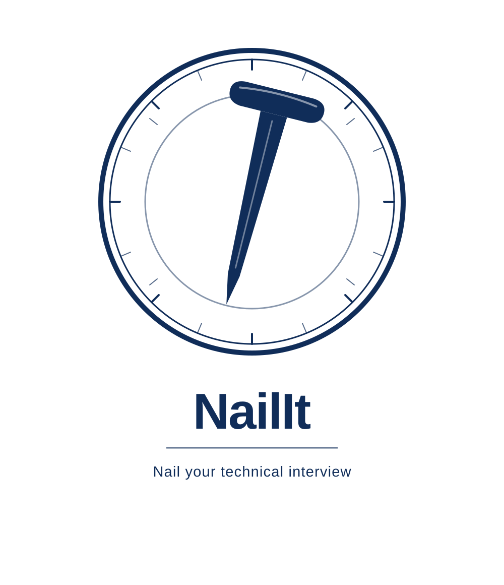

<p align="center">
  
</p>

<p align="center">
  <b>Nail your technical interview.</b><br>
  Revise and walk in with confidence.
</p>

<p align="center">
  <a href="#license"></a>
  
</p>

---

## Table of contents

- [Purpose](#purpose)
- [How it works (design)](#how-it-works-design)
- [Study mode: how it works](#study-mode-how-it-works)
- [How you level up](#how-you-level-up)
- [Assessment mode (for companies)](#assessment-mode-for-companies)
- [The question-bank format](#the-question-bank-format)
- [What data is stored, and where](#what-data-is-stored-and-where)
- [Configuration](#configuration)
- [Installation](#installation)
- [Usage](#usage)
- [Technologies](#technologies)
- [Roadmap](#roadmap)
- [License](#license)

---

## Purpose

NailIt helps you **revise for a technical interview** so you walk in able to answer
most questions with confidence. The goal is not to know everything — it is to be
solid across a topic and to go deep where it counts.

You load a **question bank** (a standardized, validatable file of questions with
answers), pick what you want to revise — say `cybersecurity`, optionally narrowed
to `access-control` — and NailIt asks you questions. When you do not know one, you
reveal the explanation. When you do, the engine takes you deeper.

The same format powers two uses:

- **Study mode** — for the person preparing: self-paced revision with incremental,
  spaced-repetition learning.
- **Assessment mode** — for a company: build an ad-hoc test from a question bank
  and run it on candidates with automatic grading.

What it is **not**: it does not generate questions or answers (everything comes
from the bank you load), and it needs no network or paid service to study — it runs
locally.

---

## How it works (design)

NailIt is a Python **library** with a thin **CLI** on top. The product at the
center is the **question-bank format**; everything else consumes it.

```
                 Use cases:  study.py  /  assessment.py
                               |              |
                 +-------------+              +-------------+
                 v                                          v
            Loader + JSON Schema                      Scheduler (engine)
            (validates the bank)                      pure logic, no I/O
                 |                                          |
                 v                                          v
            QuestionBank  (content, shareable)      UserState (progress, local)
                 ^                                          ^
            bank JSON/YAML                           state store (local JSON)
```

- **Loader** reads a JSON/YAML bank, validates it against a JSON Schema, and
  refuses to load anything malformed — so the engine never sees bad data.
- **Scheduler** is the heart: given your state and the bank, it picks the next
  question and updates your progress after each answer. It is pure logic (no files,
  no clock), which makes it predictable and fully testable.
- **Store** saves your progress locally, separate from the bank and keyed by a
  stable question id, so updating the bank never wipes your history.

Full requirements and design live in [`docs/`](docs/).

---

## Study mode: how it works

A study session runs over a **scope** you choose: a domain, optionally narrowed to
one topic. Each round is a simple loop:

How a question is handled depends on its **type**, because the two kinds have very
different needs.

**Choice questions** (`single_choice`, `multiple_choice`, `true_false`) — the
engine knows the right answer, so it checks you objectively:

1. You **pick an option** (type the index, or indices for multiple choice). For
   multiple-choice questions the "more than one answer" hint is **highlighted in
   orange** — reusing the `(multiple answers)` cue already in the question text when
   it is there, so there is no duplicate label.
2. Before revealing anything, NailIt asks **"were you confident?"** — asked *first*
   so a lucky guess cannot be relabelled as knowledge afterwards.
3. It tells you **Correct ✓** or **Wrong ✗** (with the right answer) and shows the
   **why** (the `explanation`).
4. It **derives the grade** by combining the result with your confidence:

   | Result | Confidence | Grade |
   |---|---|---|
   | correct | confident | know it |
   | correct | just guessing | unsure |
   | wrong | — | don't know |

   So a true/false you got right by flipping a mental coin lands as *unsure* — it
   comes back soon and does **not** unlock the next level. Guessing does not fake
   learning.

**Open questions** (`open`) — there is no option to check, so you are the judge:

1. You answer in your head and press **Enter** to reveal the answer and the **why**.
2. You **self-assess** with four grades: `1` don't know · `2` unsure · `3` know it ·
   `4` know it well.

In both cases the grade then updates two things for that question:
- **mastery** (0 → 1): how well you know it;
- **due date**: when it should come back.

A low grade drops mastery and brings the question back **soon** (seconds to
minutes). A high grade raises mastery and pushes the next review **far out** (a day,
a week) — classic **spaced repetition**: you see what you struggle with often, and
what you know rarely.

The session keeps asking until you quit or nothing is due right now. Everything is
saved to your profile, so you can stop and resume exactly where you were.

So self-assessment did not disappear — it does the job only where it makes sense
(open questions, where no machine can judge you). Choice questions are graded on the
objective outcome plus a single confidence check. (In assessment mode, below, there
is no self-grading at all — the machine decides.)

---

## How you level up

This is the part that makes NailIt more than flashcards. Questions on the same
topic are linked into a **chain** by a shared `level_chain`, ordered by `level`
(1 → 2 → 3). The sample bank, for example, chains RBAC like this:

```
access-control-rbac:
  level 1  "What is RBAC?"                         (open)
  level 2  "RBAC vs ABAC?"                          (single choice)   prereq: level 1
  level 3  "Apply least privilege with RBAC at scale" (open)         prereq: level 2
```

Two separate thresholds govern progression — this distinction is the key idea:

- **Advance threshold (low).** The moment you grade a question **"know it"** (or
  better), you have *proven* you know that level. That single success is enough to
  **unlock the next level** in the chain. You do not have to grind a question ten
  times to move up — knowing it once opens the door. This is **verticalization**:
  answer "What is RBAC?" correctly and the engine is now willing to ask you "RBAC vs
  ABAC?", then the scenario-style level 3.

- **Mastery threshold (high).** Reached only by **consolidating** — several
  positive reviews over time. This higher bar is what marks a chain as "mastered"
  and drives the second behavior below. It is about durability, not just a one-off
  correct answer.

On top of climbing a chain, the engine keeps you **balanced** and lets you pick
*how* deep vs. broad to go.

- **Prerequisites.** A question never appears until its prerequisites are passed, so
  you are never shown the advanced RBAC scenario before you have shown you know what
  RBAC even is.

### Learning mode: depth, breadth or balanced

You choose the strategy with `--mode` (or `learning_mode` in config):

- **`balanced`** (default) — mixes verticalization with cross-topic balancing. After
  you show you know the RBAC basics, it does not drill RBAC relentlessly: it pulls
  you over to cryptography or network security to keep your overview wide, while
  still letting you climb chains. Good for general interview prep.
- **`breadth`** — "overview first". It covers **every topic's basics before going
  deeper**: you will see all the level-1 questions across the domain before any
  level-2 appears. Pick this when you want to **broaden your spectrum** rather than
  master one topic — exactly the "I just want to know more in general" case.
- **`depth`** — turns balancing off and verticalizes freely: as soon as a level
  unlocks, the deeper levels of that chain come right up. Pick this to drill one
  topic hard.

```bash
nailit study --domain cybersecurity --mode breadth   # cover the basics everywhere
nailit study --domain cybersecurity --mode depth     # drill one chain deep
```

### Mastery decays if you neglect it

Levelling up is not permanent. Every answer sets a **review due date**, and once a
question is overdue its **effective mastery decays** over time — halving every
`decay_half_life` (default 7 days past due). The decay is *lazy*: nothing runs in
the background and your stored progress is not rewritten; the engine simply
discounts stale mastery when it decides what to ask.

The practical effect is the "malus" you would expect:

- A chain you mastered and then ignored **drops out of "mastered"** after a long
  enough gap, and its questions resurface near the top of the queue.
- A neglected **prerequisite can re-lock** its advanced questions until you refresh
  it — so coming back after a month, you revisit the basics before the engine
  trusts you with the hard stuff again.
- When you do answer after a gap, your grade is applied on top of the *decayed*
  value, not the stale one, so one correct answer does not instantly restore
  weeks-old confidence.

Set `decay_half_life: 0` to disable decay entirely.

Put together, a session walks you **from simple to detailed within a topic, while
rotating across topics** (in `balanced`/`breadth`), and keeps you honest over time.
All of these knobs live in configuration (see [Configuration](#configuration)) with
sensible defaults, so it works out of the box.

---

## Assessment mode (for companies)

The same bank can drive a test for candidates. Here there is **no self-assessment**
— the candidate answers, and NailIt grades objectively:

- `build_test` selects questions by domain / topic / level and a count, with a
  **balanced mix across topics** (round-robin so no single topic dominates).
- `grade_test` **auto-grades the choice questions** (`single_choice`,
  `multiple_choice`, `true_false`) against the bank's correct answers and returns a
  score plus per-question detail.
- `open` questions are **flagged for human review** — they get no automatic score
  in v1 (AI grading of free-text answers is on the roadmap).

Assessment data is kept separate from anyone's study progress, even though both
read the same question bank. Today assessment mode is available as a library
(`nailit.assessment`); a `nailit assess` CLI command is the next task.

---

## The question-bank format

A question bank is a JSON (or YAML) file conforming to the schema in
[`src/nailit/schema/question_bank.schema.json`](src/nailit/schema/question_bank.schema.json).
Validate any bank before using it:

```bash
nailit validate path/to/bank.json
```

The validator reports **all** problems at once, each with the field and id
involved, rather than stopping at the first.

Each question has:

| Field | Required | Description |
|---|---|---|
| `id` | yes | stable, unique identifier (your progress is keyed to it) |
| `domain` / `topic` | yes | domain and topic within it |
| `level` | yes | difficulty, integer ≥ 1 |
| `type` | yes | `open`, `single_choice`, `multiple_choice`, `true_false` |
| `question` | yes | the prompt |
| `answer` | for `open` | the answer/explanation text |
| `choices` / `correct` | for choice types | options and the correct index/indices |
| `explanation` | no | deeper explanation shown after the answer |
| `tags` | no | free tags |
| `level_chain` | no | links the rising levels of one topic (enables verticalization) |
| `prerequisites` | no | ids that must be passed before this one appears |

Choice questions are **auto-gradable** (they work in both study and assessment).
`open` questions work in study mode via self-assessment; in assessment mode they are
left for human review.

**Writing good `explanation`s.** The `explanation` is shown as the "why" after every
answer, so make it self-contained: say *why* the correct option is correct (and,
ideally, why the tempting wrong ones are wrong) rather than just restating the
answer. For choice questions this is what turns "I got it right" into actual
understanding.

A minimal example:

```json
{
  "name": "my-bank",
  "version": "1",
  "questions": [
    {
      "id": "net-osi-001",
      "domain": "networking",
      "topic": "osi-model",
      "level": 1,
      "type": "single_choice",
      "question": "Which OSI layer does IP operate at?",
      "choices": ["Layer 2 (Data link)", "Layer 3 (Network)", "Layer 4 (Transport)"],
      "correct": [1],
      "explanation": "IP is the Layer 3 (Network) protocol responsible for addressing and routing.",
      "level_chain": "osi"
    }
  ]
}
```

A complete, multi-topic reference bank ships at
[`src/nailit/data/sample_cybersecurity.json`](src/nailit/data/sample_cybersecurity.json)
(a 3-level RBAC chain plus cryptography and network-security topics).

---

## What data is stored, and where

Everything is **local**. NailIt never uploads anything.

- **Your progress** is a JSON file per profile and bank, under `state_dir`
  (default `.nailit_state/`), named `<profile>__<bank>.json`. It holds, per
  question: `mastery`, the next `due_at`, `times_seen` and your `last_grade`.
- **The question bank** is never modified — it is read-only content.
- Progress is keyed by the question's **stable id**, so if you add questions to a
  bank, your existing progress is preserved and the new questions simply start
  fresh.

A **profile** is simply the name you pass with `--profile` (default `default`) —
there is no account or login, it just decides under which name your progress is
saved. Different profiles are fully isolated: `--profile alice` and `--profile bob`
keep separate histories on the same bank. List the ones you already have with
`nailit profiles`. A missing or corrupt state file is handled gracefully by
starting from an empty state (your bank is never at risk).

---

## Configuration

Copy `config.example.yaml` to `config.yaml` and adjust. Every field is optional —
omit the `engine` block entirely to use the defaults.

```yaml
bank_path: src/nailit/data/sample_cybersecurity.json  # which bank to load
profile: default                                       # whose progress
state_dir: .nailit_state                               # where progress is saved

engine:
  interval_dont_know: 30       # review intervals per grade, in seconds
  interval_unsure: 120
  interval_know: 86400         # 1 day
  interval_know_well: 604800   # 7 days
  mastery_up: 0.34             # mastery gain on "know it"
  mastery_down: 0.5            # mastery reduction factor on "don't know"
  advance_threshold: 0.3       # cross this to unlock the next chain level
  mastery_threshold: 0.8       # cross this (via consolidation) to "master" a chain
  balance_weight: 1.0          # how hard to pull toward less-covered topics (0 = off)
  learning_mode: balanced      # depth | breadth | balanced
  decay_half_life: 604800      # effective mastery halves every N seconds past due (0 = off)
```

Pass a config file with `--config config.yaml`; CLI options like `--profile` and
`--mode` override it for that run.

---

## Installation

```bash
python3 -m venv .venv && source .venv/bin/activate
pip install -e ".[dev]"
```

Requires Python 3.10+.

---

## Usage

Validate a bank:

```bash
nailit validate src/nailit/data/sample_cybersecurity.json
```

See which profiles you already have (a profile is just the name you pass to
`--profile`; the default is `default`):

```bash
nailit profiles
```

```
Profiles with saved progress (in '.nailit_state'):
  • alice   (banks: cybersecurity-basics)
  • default (banks: cybersecurity-basics)
```

See what you can study — domains, their topics, and the levels available (handy to
find the values for `--domain` / `--topic`):

```bash
nailit topics                              # the bundled sample bank
nailit topics my-bank.json                 # a specific bank
nailit topics --domain cybersecurity       # just one domain
```

```
Bank: cybersecurity-basics (7 questions)
cybersecurity  (7 questions)
  • access-control  (3 questions, levels 1, 2, 3)
  • cryptography  (2 questions, levels 1, 2)
  • network-security  (2 questions, levels 1, 2)
```

Start a study session (uses the bundled sample bank if you don't pass one):

```bash
nailit study --domain cybersecurity
nailit study --domain cybersecurity --topic access-control --profile mario
nailit study --domain cybersecurity --mode breadth   # cover the basics everywhere
```

Options: `--topic` narrows the scope, `--profile` keeps progress separate, and
`--mode` picks the learning strategy (`depth` / `breadth` / `balanced`).

During a session, **choice questions** are checked automatically: type the option
index (or `1,2` for multiple choice), say whether you were confident, and NailIt
tells you right or wrong and derives the grade. **Open questions** you reveal with
**Enter** and self-grade **1** (don't know) / **2** (unsure) / **3** (know it) /
**4** (know it well). Type **q** at any prompt to quit — progress is saved as you
go.

See your results at any time, including after you quit with `q`:

```bash
nailit progress --domain cybersecurity              # default profile
nailit progress --domain cybersecurity --profile mario
```

```
Progress — profile 'mario', bank 'cybersecurity-basics'
cybersecurity  —  3/7 questions seen, avg mastery 15%
  █░░░░░░░░░   11%  access-control  (1/3 seen)
  ██░░░░░░░░   17%  cryptography  (1/2 seen)
  ██░░░░░░░░   17%  network-security  (1/2 seen)
  still working on: access-control-rbac, crypto-basics, net-security
```

Mastery shown is the *effective* value (after time decay), so it reflects what the
engine currently believes — a topic you have not reviewed in a while shows lower.

Run the tests:

```bash
pytest
```

---

## Technologies

- **Python 3.10+**
- [Pydantic](https://docs.pydantic.dev/) — domain models and structural validation
- [jsonschema](https://pypi.org/project/jsonschema/) — the formal bank-format contract
- [Typer](https://typer.tiangolo.com/) — the CLI
- [PyYAML](https://pypi.org/project/PyYAML/) — configuration and YAML banks
- [pytest](https://pytest.org/) — tests
- Planned: [FastAPI](https://fastapi.tiangolo.com/) for the phase-2 API

---

## Roadmap

- **v1** (current): question-bank format + validation, the incremental engine,
  study mode over the CLI, assessment grading as a library, a sample bank,
  configuration.
- **Phase 2**: a FastAPI API on top of the same use cases; a `nailit assess` CLI
  command.
- **Phase 3+**: AI grading of free-text (`open`) answers; a mobile app consuming the
  API.

---

## License

[MIT](LICENSE) © NailIt contributors.
